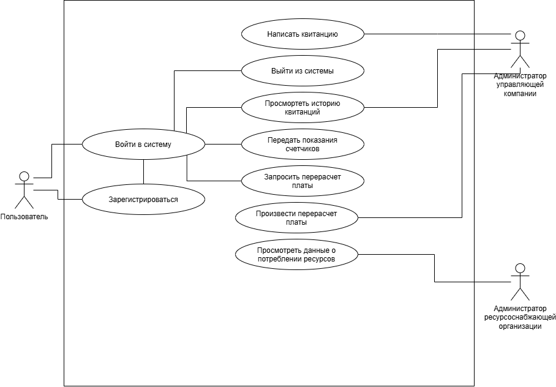
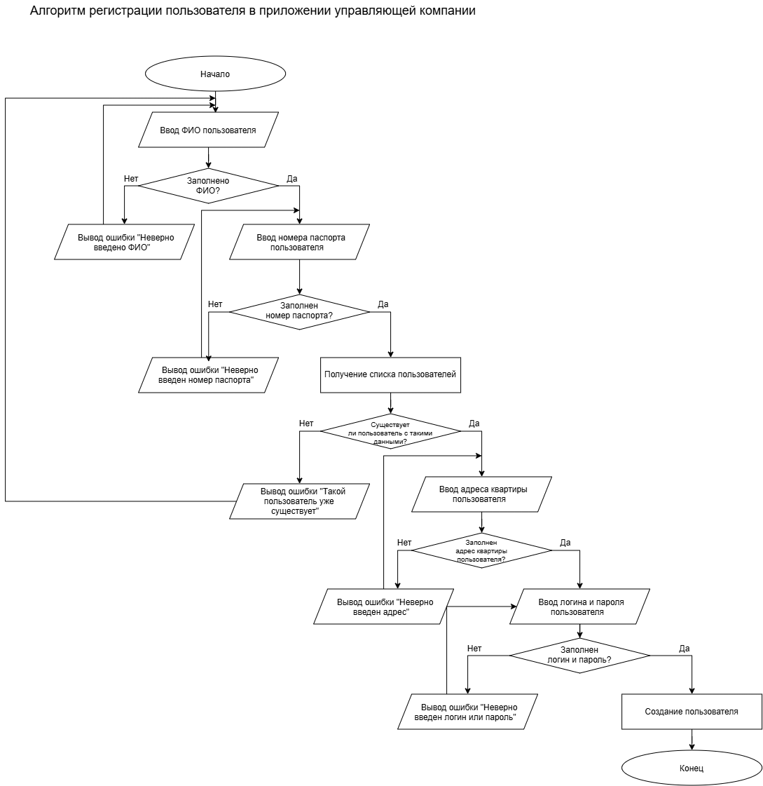
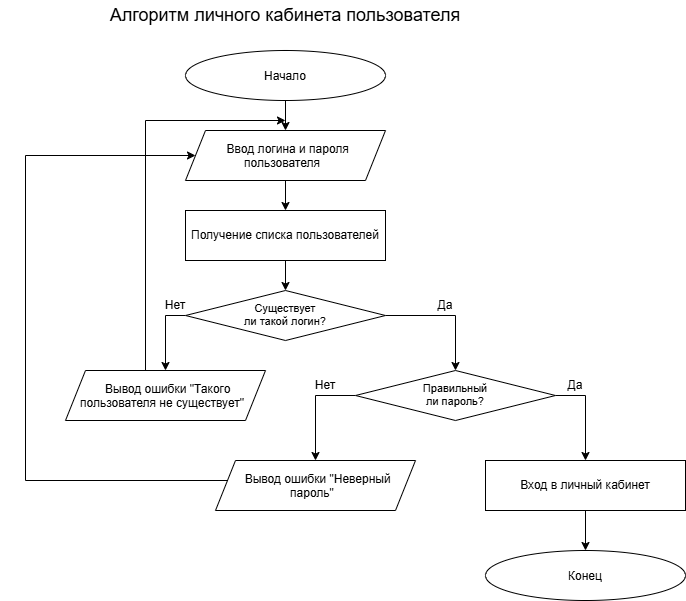
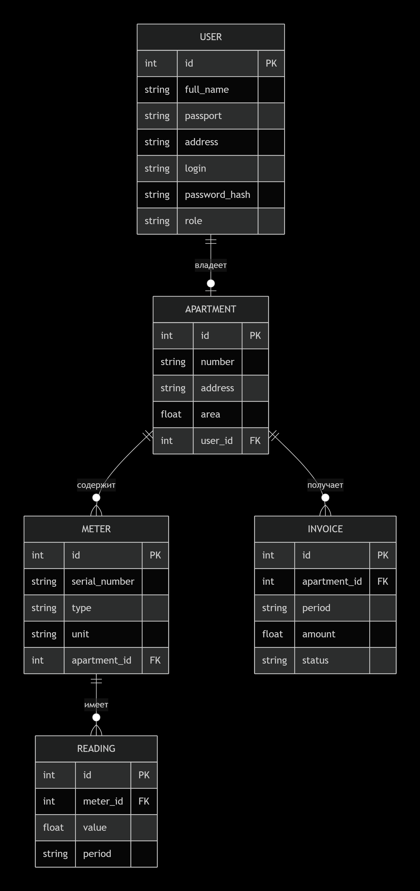

**UK_App** - консольное приложение для учета платежей за комунальные услуги. Проект предназначен для автоматизации комплекса процессов по работе с лицевыми счетами, расчетами и взаимодействием с жителями. Приложение позволяет регистрировать жителей в личный кабинет, в котором они могут авторизоваться, передать показания счетчиков и произвести перерасчет. Также приложение позволяет управляющим компаниям администрировать базу данных и взаимодействовать с жителями; ресурсоснабжающим организациям получать данные о потреблении ресурсов.

# Возможности

В проекте реализованы следующие основные возможности:
- регистрация пользователей
- автроизация пользователей
- управление пользователями
- хранение электронных квитанций
- передача показаний счетчиков
- перерасчет платы
- работа с ресурсоснабжающими организациями
- хранение данных в базе данных

# Архитектура

В проекте используется многослойная архитектура:

- Пользователь
- Консольный интерфейс
- Сервисный слой
- Слой доступа к данным
- База данных

# Диаграмы

## UseCase

## Регистрация

## Личный Кабинет

## База данных
